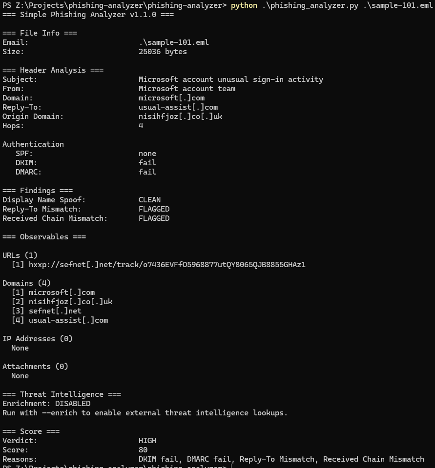

## Simple Phishing Analyzer

A Python-based phishing analyzer that parses .eml files and performs 
automated triage including header analysis, URL extraction with VirusTotal 
enrichment, attachment hashing with MalwareBazaar lookup, and risk scoring.

<<<<<<< HEAD
## Usage:
=======
## Usage
>>>>>>> a15f8c82aa5edfd7f4d0e6650c941683a57308b5
Windows:
```
python phishing_analyzer.py <path-to-file.eml>
```

Linux/Mac: 
```
python3 phishing_analyzer.py <path-to-file.eml>
```
Tested using Python 3.10.11

Requirements:
```
pip install -r requirements.txt
```
## API Keys

This tool uses the following free APIs:
- VirusTotal: https://www.virustotal.com  (free account recommended)
- MalwareBazaar: https://auth.abuse.ch  (free account recommended)

URL and attachment analysis will be skipped if keys are not present. The tool will still perform header analysis and scoring without API keys.

Add keys to a `.env` file in the project directory:
```
VT_API_KEY=your_key_here
MB_API_KEY=your_key_here
```
## Sample Data

Test emails sourced from: https://github.com/rf-peixoto/phishing_pot/

## Features

<<<<<<< HEAD
✅ 1. Email Parsing  
✅ 2. Header Analysis  
✅ 3. URL Extraction  
✅ 4. Attachment Analysis  
✅ 5. Scoring and Report
=======
- Email Parsing  
- Header Analysis  
- URL Extraction  
- Attachment Analysis  
- Scoring and Report
- MITRE ATT&CK Mapping: T1566 (Phishing), T1566.001 (Spearphishing Attachment), T1566.002 (Spearphishing Link)

>>>>>>> a15f8c82aa5edfd7f4d0e6650c941683a57308b5

## Sample Output



## Code Quality
- Type checked with mypy
- Unit tested with unittest

## Version
1.0.0

## Author: Philip Zangara

License: MIT

Disclaimer: Built independently, with AI used as a learning aid for guidance and debugging feedback.
